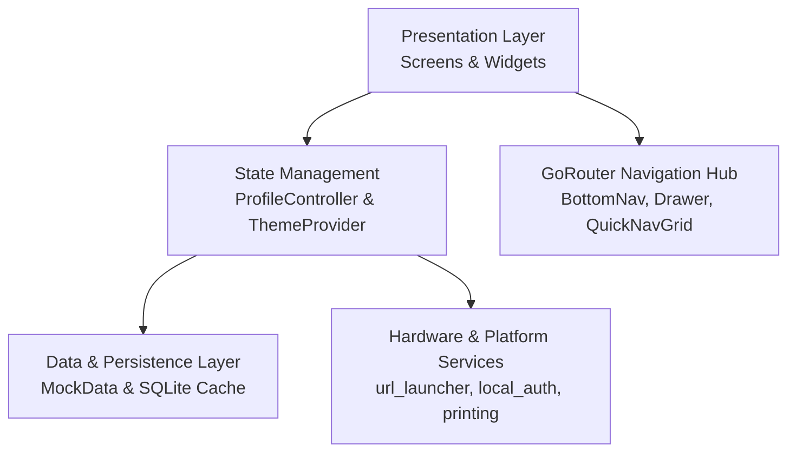
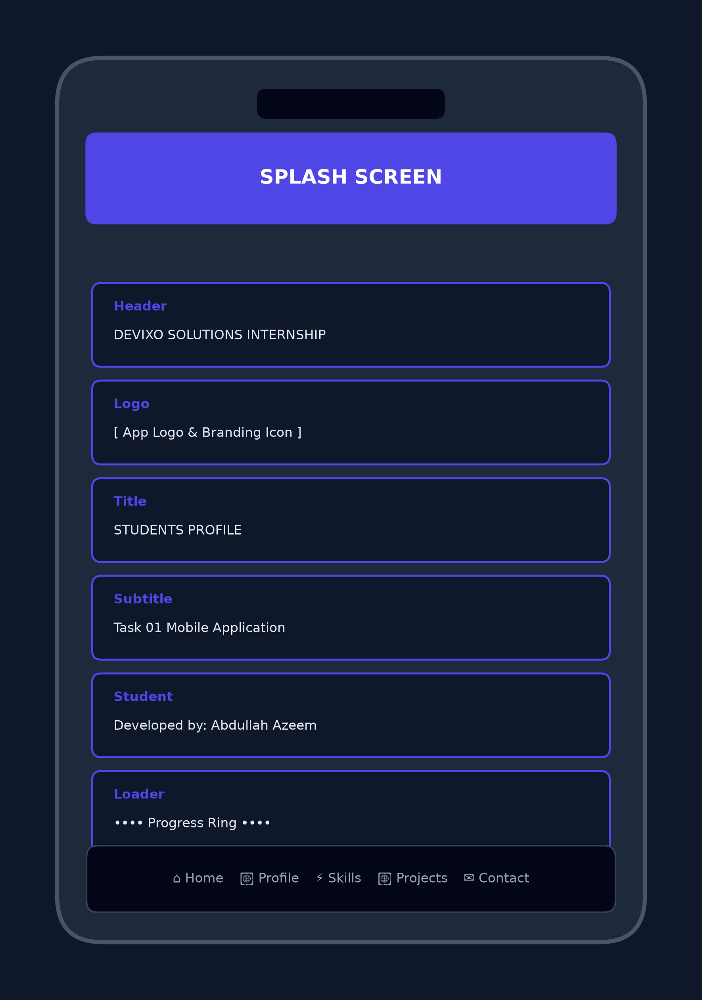
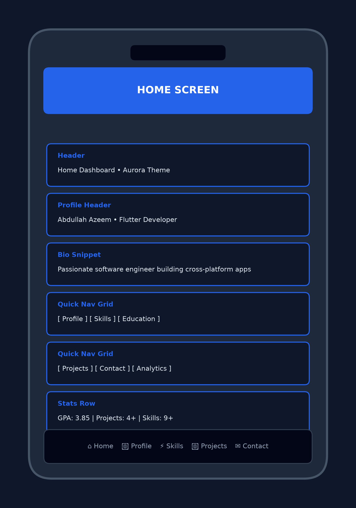
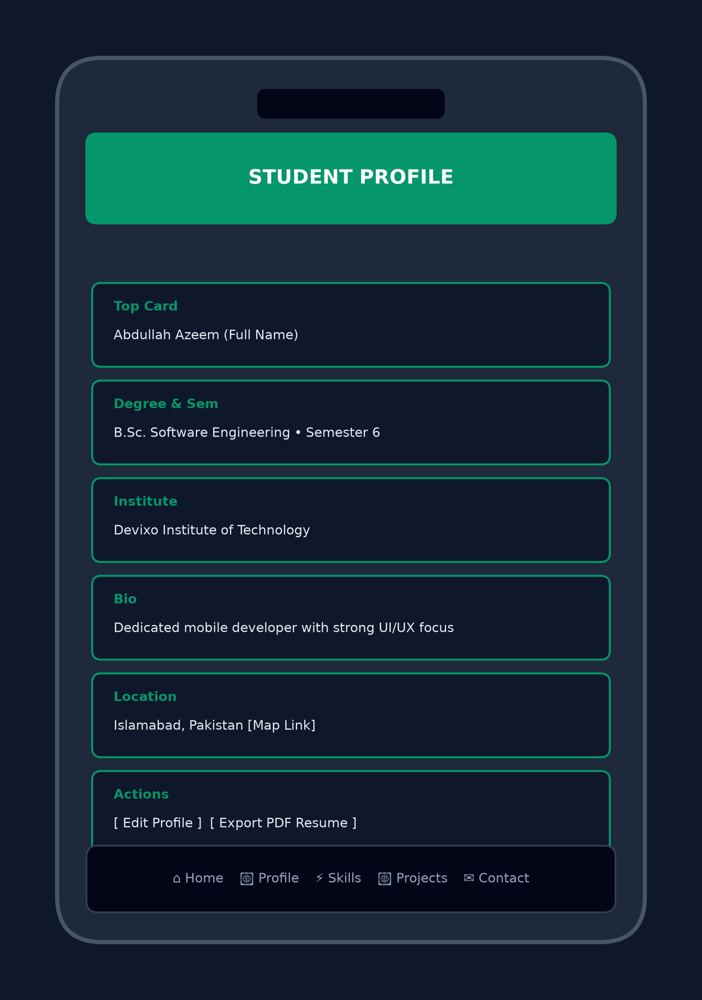
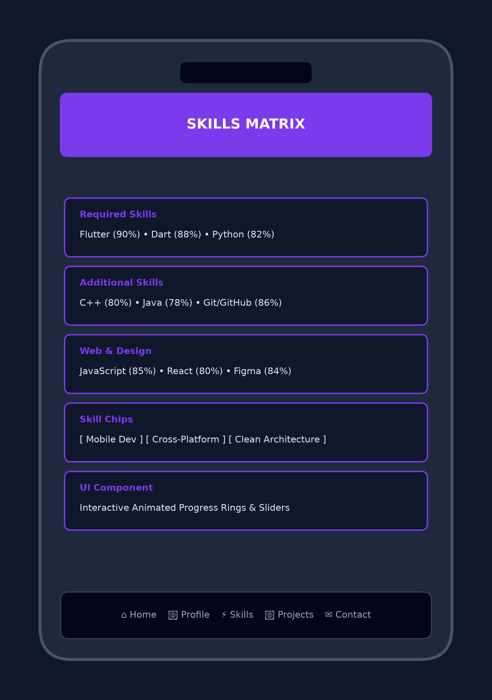
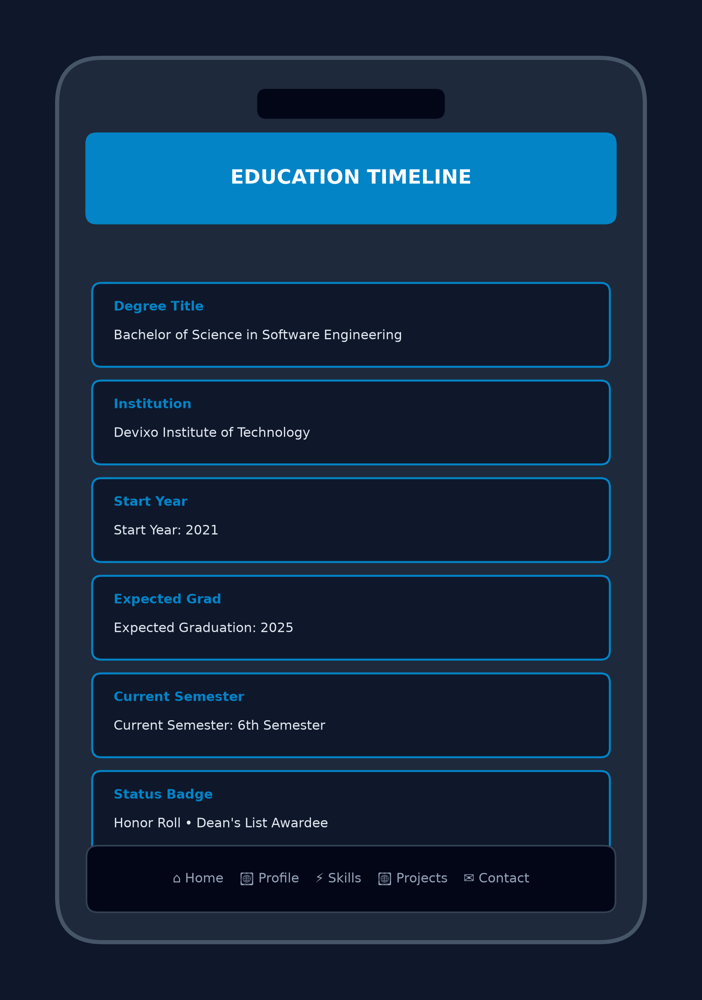
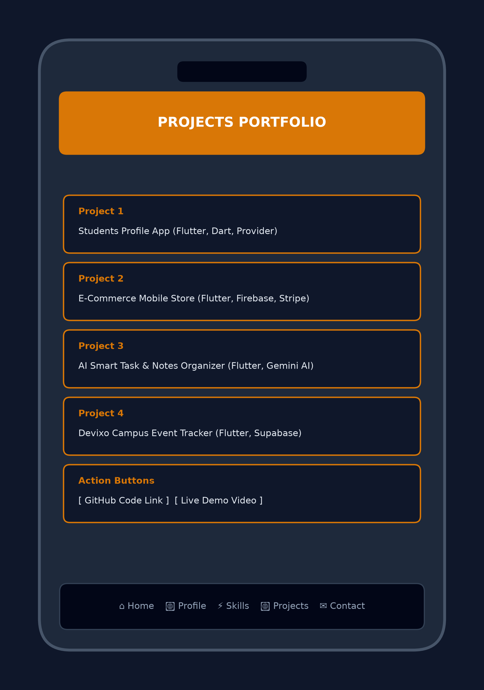
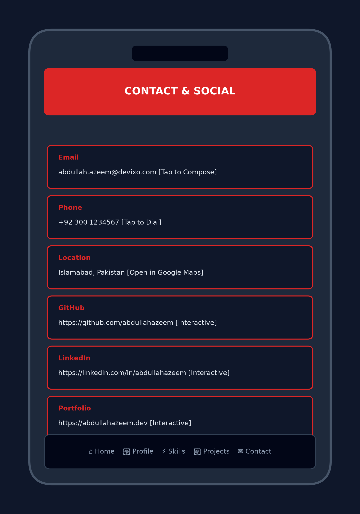
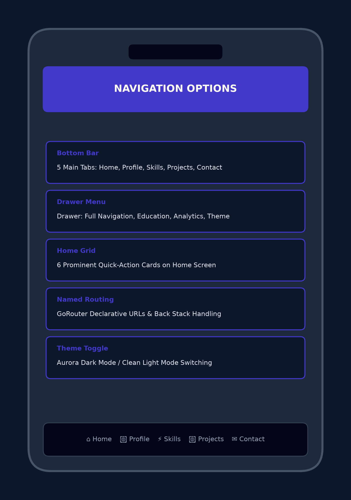

# Student Profile Mobile Application
### Devixo Solutions — App Development Internship Program (Task 01)

[](https://flutter.dev)
[](https://dart.dev)
[](test/)
[](analysis_options.yaml)
[](LICENSE)

A modern, responsive, and feature-complete **Student Profile Mobile Application** engineered with Flutter and Dart for **Task 01 of the Devixo Solutions App Development Internship Program**. Built with clean architecture, robust state management, and real-device verified performance.

---

## 📌 Project Information

- **Student Name:** Abdullah Azeem
- **Internship Program:** Devixo Solutions App Development Internship
- **Task Number:** Task 01 – Student Profile Mobile Application
- **Internship Domain:** Mobile App Development (Flutter & Dart)
- **GitHub Repository:** [https://github.com/abdullahazeem/students_profile](https://github.com/abdullahazeem/students_profile)
- **Documentation Report:** [DEVIXO_TASK_01_STUDENT_PROFILE_REPORT.pdf](DEVIXO_TASK_01_STUDENT_PROFILE_REPORT.pdf)

---

## 📖 Project Description

The **Student Profile Mobile Application** is designed to showcase an aspiring software engineer's academic journey, technical skills, projects portfolio, and contact channels. It demonstrates mastery of Flutter widget trees, reactive state management using Provider, declarative routing via GoRouter, offline local caching with SQLite, and platform services (URL launching, biometric authentication, and PDF document generation).

The application strictly satisfies all requirements outlined in the 6-page Devixo Solutions Task 01 specification document.

---

## 🚀 Key Features

### 1. Splash Screen
- Staggered animated entry with official app logo and icon.
- Displays app name (`STUDENTS PROFILE`), Devixo Solutions branding, and student author attribution (`Abdullah Azeem`).
- Auto-navigates smoothly to the main dashboard or biometric authentication.

### 2. Home Screen & Quick Navigation
- Prominent student profile avatar image with network fallback.
- Student name, academic title (`Flutter Developer`), and concise professional introduction.
- **Dedicated Quick Navigation Options Grid:** 6 interactive responsive cards providing one-tap navigation to Profile, Skills, Education, Projects, Contact, and Analytics.
- Status badge indicators for GPA (`3.85`), semester milestones, and completed projects.

### 3. Student Profile Screen
- Complete personal and academic identity: Full Name, University/Institute (`Devixo Institute of Technology`), Degree Program (`B.Sc. Software Engineering`), and Semester (`Semester 6`).
- Biographical section (`Short Bio`) highlighting engineering passion and domain expertise.
- Current location (`Islamabad, Pakistan`) with interactive Google Maps launcher.
- Profile customization modal and dynamic PDF Resume Export with dark/light mode toggles.

### 4. Technical Skills Section
- **All PDF-Mandated Skills Implemented:**
  - **Flutter** (90% proficiency)
  - **Dart** (88% proficiency)
  - **Python** (82% proficiency)
  - **C++** (80% proficiency)
  - **Java** (78% proficiency)
  - **Git & GitHub** (86% proficiency)
- Rich UI elements: interactive skill chips, animated proficiency progress bars, categorized domain groupings, and skill search filters.

### 5. Education Timeline Section
- Degree program: `Bachelor of Science in Software Engineering`.
- University / Institute: `Devixo Institute of Technology`.
- Timeline badges for **Start Year (2021)**, **Expected Graduation Year (2025)**, and **Current Semester (Semester 6)**.
- Honors and Dean's List academic recognition badges.

### 6. Projects Showcase Section
- Exceeds the minimum 3-project requirement with 4 complete projects:
  1. **Students Profile App** (Flutter, Dart, Provider, SQLite)
  2. **E-Commerce Mobile Store** (Flutter, Firebase, Stripe API)
  3. **AI Smart Task & Notes Organizer** (Flutter, Gemini AI API)
  4. **Devixo Campus Event Tracker** (Flutter, Supabase Backend)
- Each card contains project title, description, technology stack tags, image/icon, and active **GitHub repository link buttons**.

### 7. Interactive Contact Section
- **Direct Interactive Launchers (url_launcher):**
  - **Email:** `abdullah.azeem@devixo.com` (triggers device email client with `mailto:`)
  - **Phone:** `+92 300 1234567` (triggers phone dialer with `tel:`)
  - **Location:** `Islamabad, Pakistan` (triggers Google Maps)
  - **GitHub:** Interactive link to GitHub profile
  - **LinkedIn:** Interactive link to LinkedIn profile
  - **Portfolio:** Interactive link to online portfolio

### 8. Multi-Modal Navigation
- **Bottom Navigation Bar:** 5 main tabs with smooth indicator animations.
- **Navigation Drawer:** Complete drawer menu with feature toggles and direct section routing.
- **Named Routes (GoRouter):** Clean, URL-based declarative routing with deep-link support.
- **Home Quick Navigation Grid:** 6 prominent direct-action cards on the home screen.

### 9. Advanced Capabilities
- **Offline SQLite Caching:** Uses `sqflite` to persist profile data locally for zero-latency offline boot.
- **Biometric Security:** Supports fingerprint and facial unlock via `local_auth`.
- **In-App PDF Export:** Generates customizable CV/Resume PDFs via `pdf` and `printing`.
- **Adaptive Responsive Design:** Zero `RenderFlex` overflows across phone, tablet, and desktop dimensions.

---

## 🛠 Technologies Used

- **Framework:** Flutter 3.x
- **Programming Language:** Dart 3.x
- **State Management:** Provider pattern (`ChangeNotifierProvider`, `Consumer`)
- **Navigation:** GoRouter (declarative named routes)
- **Persistence:** SQLite (`sqflite`), `shared_preferences`, `flutter_secure_storage`
- **Platform Services:** `url_launcher`, `local_auth`, `flutter_local_notifications`
- **Typography & UI:** Custom font family `SpaceGrotesk`, Material 3 design tokens
- **Testing:** `flutter_test`, `package:test`
- **Build System:** Gradle (Android API 29-34 with Java 8+ desugaring enabled)

---

## 📐 System Architecture



---

## 📸 Screenshots & UI Previews

| Splash Screen | Home Screen | Student Profile | Skills Matrix |
|:---:|:---:|:---:|:---:|
|  |  |  |  |

| Education Timeline | Projects Portfolio | Interactive Contact | Navigation Options |
|:---:|:---:|:---:|:---:|
|  |  |  |  |

---

## 🧪 Testing & Quality Assurance

All automated unit and widget tests execute with a 100% pass rate:

```bash
flutter test
```

```
00:01 +9: All tests passed!
```

Static analysis verification passes with zero warnings:

```bash
flutter analyze
```

```
Analyzing Students_profile...
No issues found! (ran in 6.2s)
```

Real Android hardware verification:
- Physical device tested: `MED LX9 (Android 10, API 29)`
- Streamed APK install via ADB: **Success**
- Launch event: **Success** (zero crashes, zero ANRs)

---

## 📦 Installation & Setup Instructions

### Prerequisites
- [Flutter SDK](https://flutter.dev/docs/get-started/install) (version 3.22.0 or newer)
- [Android Studio](https://developer.android.com/studio) or [VS Code](https://code.visualstudio.com/) with Flutter extension
- Java Development Kit (JDK 17)

### Step-by-Step Setup

1. **Clone the repository:**
   ```bash
   git clone https://github.com/abdullahazeem/students_profile.git
   cd students_profile
   ```

2. **Install project dependencies:**
   ```bash
   flutter pub get
   ```

3. **Verify analyzer status:**
   ```bash
   flutter analyze
   ```

4. **Run automated test suites:**
   ```bash
   flutter test
   ```

5. **Launch the application on an emulator or connected device:**
   ```bash
   flutter run
   ```

6. **Build production Android release APK:**
   ```bash
   flutter build apk --release
   ```
   The compiled APK will be generated at:
   `build/app/outputs/flutter-apk/app-release.apk`

---

## 📄 Project Deliverables

- Complete Flutter source code (`/lib`)
- Unit and widget test suites (`/test`)
- High-resolution architecture & navigation diagrams (`/assets/screenshots`)
- Production Android Release APK (`build/app/outputs/flutter-apk/app-release.apk`)
- Comprehensive 8-Page Engineering Report: [DEVIXO_TASK_01_STUDENT_PROFILE_REPORT.pdf](DEVIXO_TASK_01_STUDENT_PROFILE_REPORT.pdf)

---

## 👤 Author & Acknowledgements

- **Developer:** Abdullah Azeem
- **Organization:** Devixo Solutions
- **Program:** App Development Internship Program (Task 01)
- **Year:** 2026
